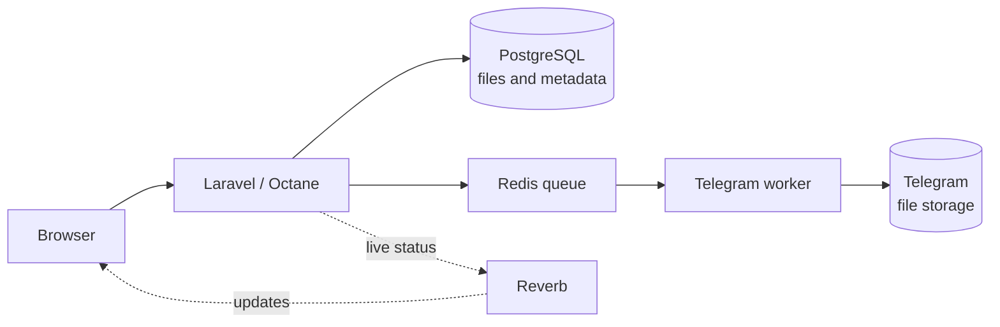

# RoxiFile

RoxiFile is a Telegram-backed virtual file manager. It stores file bytes in Telegram chats and keeps the virtual folders, file records, tags, playlists, and ownership in Database. Telegram is the physical storage layer; it does not define the user's folder structure.

## Features

- Virtual folders and file management: upload, download, preview supported media, rename, move, copy, bulk actions, trash, restore, and permanent deletion.
- Search, sortable file lists, filters, descriptions, and tags.
- Telegram storage connections through the shared Roxi MTProto account, a Telegram bot, an MTProto invite, or an optional personal Telegram account.
- Asynchronous Telegram transfers with progress updates, retries, cancellation where safe, recent transfer history, and recovery for interrupted operations.
- A media library with folders, manual and smart playlists, playback history, and browser offline playback/export.
- Optional browser-side device encryption for file contents, with an additional mode for protected metadata. Encryption is marked as a preview in the UI; review and save the recovery file before enabling it.
- Account security settings, including two-factor authentication and passkeys, plus Google sign-in when configured.
- English and Persian interfaces, including right-to-left layout.

## How it works



The dedicated `telegram:worker` process keeps the Roxi MadelineProto runtime alive and processes the `telegram` queue. Upload and download temporary files are kept on private local storage and shared by the web process and worker. Reverb delivers live transfer and worker status updates.

## Requirements

- PHP 8.5 and Composer
- Node.js and npm
- PostgreSQL for RoxiFile's application database
- Redis for queues, cache, and worker coordination
- A separate PostgreSQL database for MadelineProto state when using MTProto connections
- Telegram API credentials and a configured Roxi session for Roxi MTProto storage

Bot-only storage can run without the Roxi MTProto session, but still requires the Telegram worker. Google sign-in and Reverb are optional for local development. For full production process and recovery guidance, see [docs/RUNBOOK.md](docs/RUNBOOK.md).

## Local setup

1. Install dependencies and create the environment file:

   ```bash
   composer install
   npm install
   cp .env.example .env
   php artisan key:generate
   ```

2. Configure `.env` before running migrations. Set the application PostgreSQL connection (`DB_*`), Redis connection (`REDIS_*`), and the separate MadelineProto PostgreSQL connection (`TELEGRAM_DB_*`). Set `TELEGRAM_APP_ID`, `TELEGRAM_API_HASH`, and `TELEGRAM_ROXI_USERNAME` for Roxi MTProto mode. Do not commit credentials.

3. Create the application and MadelineProto databases, then run the application migrations:

   ```bash
   php artisan migrate
   ```

   MadelineProto manages its own tables in the database configured by `TELEGRAM_DB_*`.

4. Start the development processes in one terminal:

   ```bash
   composer run dev
   ```

   This starts Horizon, Octane, Reverb, Laravel logs, and Vite. Start Redis and PostgreSQL separately if they are not already running.

5. Start the Telegram worker and scheduler in separate terminals:

   ```bash
   php artisan telegram:worker
   ```

   ```bash
   php artisan schedule:work
   ```

   The worker must be a single instance. It consumes the `telegram` queue; do not run a generic queue worker against that queue. Horizon handles the default application queue.

6. Open the URL printed by Octane (normally `http://localhost:8000`), register an account, and sign in. Connect a Telegram group or channel from **Storage Chats**, then use **Files** to create folders and upload files. Use **Media** for playlists and offline playback.

For Roxi MTProto, a super admin must bootstrap the shared Roxi Telegram session once. Stop the worker while logging in if it currently owns the runtime lock, then run:

```bash
php artisan telegram:roxi:login
```

Start `php artisan telegram:worker` again after login. Bot, invite, and personal Telegram connection setup is available in **Storage Chats**; a bot must be present in the target chat with the required permissions.

## Build and checks

Build production frontend assets with:

```bash
npm run build
```

Run the test suite with:

```bash
php artisan test --compact
```

## Operational notes

- Keep Telegram session data and temporary files on private storage, outside the public web root.
- Keep the `telegram` queue reserved for `php artisan telegram:worker`; Horizon or a generic queue worker must not consume it.
- Run exactly one Telegram worker instance. In production, supervise it along with Octane, Horizon, Reverb, and the scheduler.
- Never place API hashes, bot tokens, login codes, two-step verification passwords, or session data in source control or logs.
- RoxiFile uses an authenticated virtual filesystem. The Telegram chat itself is not the application's folder hierarchy.
